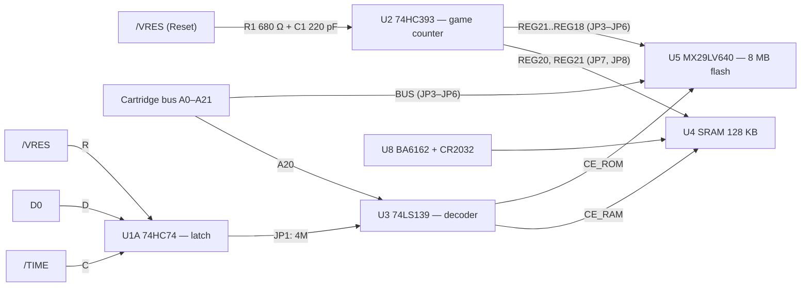

# Cart_FLASH33 — flash cartridge for Sega Mega Drive / Genesis

A universal cartridge built around the MX29LV640EBTI flash memory (8 MB), with optional battery-backed SRAM for game saves and game switching via the Reset button. It can be assembled in four variants:

| Variant | Description |
|---|---|
| **Single game** | one game ROM up to 4 MB |
| **Single game with saves** | one ROM up to 4 MB + 128 KB battery-backed SRAM |
| **Multi-game** | up to 16 ROMs, games are switched with the Reset button |
| **Multi-game with saves** | same as above + saves (up to 4 games with saves are supported) |

The variant is determined by which components are populated and by the jumper settings JP1–JP8 (see the tables below).

## Table of contents

- [Board components](#board-components)
- [How it works](#how-it-works)
- [Assembly variants](#assembly-variants)
- [Jumpers](#jumpers)
- [Saves](#saves)
- [Flash programming](#flash-programming)
- [Documentation](#documentation)

## Board components

| Ref. | Part | Function |
|---|---|---|
| CON1 | GENESIS_EDGE | cartridge edge connector: A0–A21, D0–D15, /OE, /CE, /LWR, /TIME, /VRES |
| U5 | MX29LV640EBTI | 64 Mbit (8 MB) flash, 3.3 V, x16 mode (BYTE# tied to VCC) |
| U4 | IS62C1024AS | 128K×8 SRAM for saves |
| U8 + BT1 | BA6162 + CR2032 (3 V) | SRAM battery backup, write protection on 5 V loss |
| U2 | 74HC393 | Reset press counter = game number |
| U1A | 74HC74 | D0 latch, enables the SRAM (saves) for 4 MB ROMs |
| U3A, U3B | 74LS139 | SRAM / ROM address decoder |
| U6 | XC6206P332MR | 3.3 V regulator for the flash |
| RN1–RN6, RN7–RN10 | 680 Ω, 75 Ω | series resistors on the flash address and data lines |

> The address nets in the schematic are shifted: net `A0` is the 68000 address line A1. Therefore `A20` corresponds to address `$200000` (the saves area for ROMs of 2 MB or less). SRAM selection for saves in games with ROMs larger than 2 MB is controlled by the /TIME and D0 signals.

## How it works

### Game switching via Reset

1. The `/VRES` signal goes to the U2 counter clock input through an RC noise filter (R1 680 Ω, C1 220 pF, time constant of about 150 ns). The 74HC393 counts on the falling edge.
2. The counter outputs are routed through the three-position jumpers JP3–JP6 to the upper flash address lines. The center pad of each jumper goes to the flash; one outer pad is the counter output (`REG`), the other is the bus address line (`BUS`).
3. Address lines A0–A17 go from the bus to the flash directly, through series (damping) resistors.

| Counter output | Jumper | Flash address | Size of one game |
|---|---|---|---|
| REG21 (1Q0) | JP3 | A21 | 4 MB |
| REG20 (1Q1) | JP4 | A20 | 2 MB |
| REG19 (1Q2) | JP5 | A19 | 1 MB |
| REG18 (1Q3) | JP6 | A18 | 512 KB |

The order of games in the flash image is not sequential: it follows a bit-reversed order. For example, with JP3 + JP4 set to REG, games 0, 1, 2, 3 are located at offsets 0, 4, 2, 6 MB. Keep this in mind when building the image.

There is no counter initialization (1MR is tied to GND, and the 74HC393 has no power-on reset), so the game number after power-up may be arbitrary.

## Assembly variants

"Do not populate" means the component is not installed at all.

| | Single game (ROM up to 4 MB) | Single game with saves | Multi-game (Reset, up to 16 ROMs) | Multi-game with saves (up to 4 games with saves) |
|---|---|---|---|---|
| **U2, C1, R1, C4** | do not populate | do not populate | populate | populate |
| **JP3–JP6** | all in position 2–3 (**BUS**) | all in position 2–3 (**BUS**) | depends on the number of games, see below (**REG** / **BUS**) | depends on the number of games, see below (**REG** / **BUS**) |
| **JP2 "No SAVES"** | close | close | open | open |
| **U3, C3** | do not populate | populate | do not populate | populate |
| **JP1 "2M/4M"** | open | depends on ROM size (see below) | open | depends on ROM size (see below) |
| **U1, C5** | do not populate | populate for 4 MB ROMs; do not populate for ROMs of 2 MB or less | do not populate | populate for 4 MB ROMs; do not populate for ROMs of 2 MB or less |
| **U4, U8, C2, C11, C12, R3** | do not populate | populate | do not populate | populate |
| **JP7, JP8** | open | JP7 = "0", JP8 = "0" | open | 2 games: JP7 = "0", JP8 = REG21; 4 games: JP7 = REG20, JP8 = REG21 |

The BT1 battery (CR2032, 3 V) is required in all variants with saves.

### JP3–JP6 settings for multi-game

| Configuration | JP3 | JP4 | JP5 | JP6 |
|---|---|---|---|---|
| 2 games × 4 MB | 1–2 REG | 2–3 BUS | 2–3 BUS | 2–3 BUS |
| 4 games × 2 MB | 1–2 REG | 1–2 REG | 2–3 BUS | 2–3 BUS |
| 8 games × 1 MB | 1–2 REG | 1–2 REG | 1–2 REG | 2–3 BUS |
| 16 games × 512 KB | 1–2 REG | 1–2 REG | 1–2 REG | 1–2 REG |

Multi-game ROMs can be combined: games of different sizes can be packed into one image, as long as the address lines left on the bus (BUS) do not overlap the region selected by the counter.

## Jumpers

| Jumper | Purpose | Positions |
|---|---|---|
| JP1 "2M/4M" | selects the SRAM enable condition | **<2M** — the SRAM is always enabled when A20 = 1 (`$200000–$3FFFFF`), for ROMs of 2 MB or less. **4M** — the SRAM is enabled only if the program has written D0 = 1 into the U1A latch, for 4 MB ROMs. Open when saves are not used |
| JP2 "No SAVES" | CE_ROM directly to /CE | close when building a cartridge without saves (no U3, U4, U8). Must not be closed when U3 and U4 are installed: the outputs would conflict (bus contention) |
| JP3–JP6 | upper flash address lines A21…A18 | REG (counter output) or BUS (bus) |
| JP7, JP8 | upper SRAM address lines A15, A16 | `0` — tied to GND; REG20 / REG21 — banks selected by the counter outputs |

## Saves

Saves are stored in the U4 SRAM (128 KB), which is kept powered by a battery through the BA6162. The maximum save memory size is 32 KB per game.

- **Single game, or games without separate saves:** JP7 = "0", JP8 = "0". The SRAM lines A15 and A16 are tied to GND; 32 KB is available.
- **2 games with saves:** JP7 = "0", JP8 = REG21. The 128 KB is split into banks, and each of the two games gets its own bank.
- **4 games with saves:** JP7 = REG20, JP8 = REG21. Four 32 KB banks; each of the first four games gets its own bank.
- With 8 and 16 games the banks are shared, because the SRAM has only two bank-select bits.

### SRAM selection: U3 and U1A

- The A1 input of U3A is always connected to A20; the A0 input is selected by jumper JP1.
- U1A is clocked by `/TIME` (the `$A130xx` region) and reset by RESET. If the address is not decoded any further, any access to this region can change the latch.
- The O3 output of decoder U3A drives U3B; together with /CE they produce either CE_RAM or CE_ROM, which are mutually exclusive.

### SRAM power, U8 BA6162

Vcc is taken from the 5 V rail, Vbat from the battery, and the Vo output goes through R3 (0 Ω) to the SRAM VDD (decoupled by C11). The CS output is high at normal supply voltage and goes low when Vcc drops below approximately 4.2 V; it is connected to the SRAM CE2 pin, so the memory is disabled before the voltage drops further. Below approximately 3.3 V the SRAM supply is switched to the battery. The RESET and CSB outputs are not used.

## Flash programming

The WE# pin is pulled up to 3.3 V through R2 and is not connected to `/LWR`. The location of test point TP1 makes it possible to write ROM compilations into the flash **without desoldering the chip from the board**, provided that the following conditions are met:

1. Desolder the pull-up resistor R2.
2. Connect TP1 to the `/WE` signal (the flash WE# pin) through a 680 Ω resistor.
3. Do not populate the SRAM-select ICs in the first place. If the cartridge has already been assembled, desolder them: a working SRAM chip-select circuit can interfere with flash programming.
4. Set jumpers JP3–JP6 to position 2–3 (**BUS**).
5. Close JP2 "No SAVES".

## Documentation

* 📄 **[Schematic drawing in Soviet (USSR) style](https://github.com/Viva76/Cart_FLASH33/blob/main/docs/Cartridge_schematic_A3.pdf)**
* 📄 **[Instruction manual in Soviet (USSR) style](https://github.com/Viva76/Cart_FLASH33/blob/main/docs/Instruction_KMI-01.pdf)**
>Reference designator mapping (KiCad → USSR-style drawing): U1…U5 → DD1…DD5, U6 → DA1, U8 → DA2, BT1 → GB1, CON1 → XP1, JP1…JP8 → X1…X8, RN1…RN6 → R8…R13, RN7…RN10 → R14…R17, C9…C12 → C8…C11.
* 📄 **[Cartridge schematic (PDF)](https://github.com/Viva76/Cart_FLASH33/blob/main/docs/schematic.pdf)**
* 📋 **[Bill of materials (BOM)](https://Viva76.github.io/Cart_FLASH33/ibom.html)**
* 📦 **[Gerber files for PCB manufacturing](https://github.com/Viva76/Cart_FLASH33/blob/main/Gerber/Cart_FLAH33-gerber.rar)**

