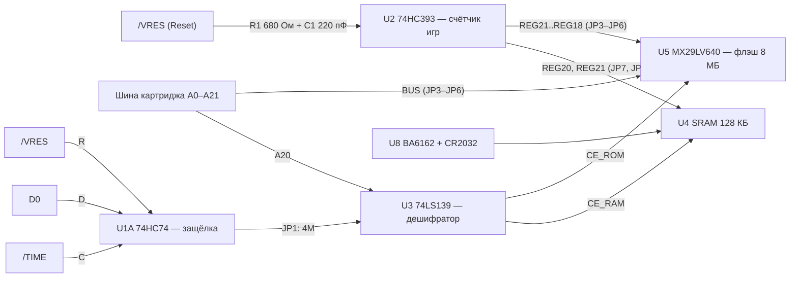

# Cart_FLASH33 — флэш-картридж для Sega Mega Drive / Genesis

Универсальный картридж на флэш-памяти MX29LV640EBTI (8 МБ), с возможностью сохранений на SRAM памяти и переключением игр по Reset. Может собираться в четырёх вариантах:

| Вариант | Что это |
|---|---|
| **Одноигровка** | один ром игры до 4 МБ |
| **Одноигровка с сохранениями** | один ром до 4 МБ + SRAM 128 КБ с батарейкой |
| **Многоигровка** | до 16 ромов, переключение игр кнопкой Reset |
| **Многоигровка с сохранениями** | то же + сохранения (поддерживается до 4 игр с сохранениями) |

Вариант определяется тем, какие детали впаяны и как стоят перемычки JP1–JP8 (таблица ниже).

## Содержание

- [Состав платы](#состав-платы)
- [Как это работает](#как-это-работает)
- [Варианты сборки](#варианты-сборки)
- [Перемычки](#перемычки)
- [Сохранения](#сохранения)
- [Прошивка флэша](#прошивка-флэша)
- [Документация](#документация)

## Состав платы

| Поз. | Деталь | Роль |
|---|---|---|
| CON1 | GENESIS_EDGE | краевой разъём картриджа: A0–A21, D0–D15, /OE, /CE, /LWR, /TIME, /VRES |
| U5 | MX29LV640EBTI | флэш 64 Мбит (8 МБ), 3,3 В, режим x16 (BYTE# на VCC) |
| U4 | IS62C1024AS | SRAM 128K×8 для сохранений |
| U8 + BT1 | BA6162 + CR2032 (3 В) | питание SRAM от батареи, защита записи при пропадании 5 В |
| U2 | 74HC393 | счётчик нажатий Reset = номер игры |
| U1A | 74HC74 | защёлка бита D0, включает сохранения SRAM для ромов 4 МБ |
| U3A, U3B | 74LS139 | дешифратор SRAM / ROM |
| U6 | XC6206P332MR | стабилизатор 3,3 В для флэша |
| RN1–RN6, RN7–RN10 | 680 Ом, 75 Ом | последовательные резисторы на адресах и данных флэша |

>Адресные цепи на схеме названы со сдвигом: цепь `A0` — это линия A1 процессора 68000. Поэтому `A20` соответствует адресу `$200000` (область сохранений для ромов не более 2Мб). Выбор SRAM для сохранений игр с ромами более 2Мб управляется сигналами /TIME D0.

## Как это работает

### Переключение игр по Reset

1. Сигнал `/VRES` через сглаживающий RC-фильтр (R1 680 Ом, C1 220 пФ, постоянная около 150 нс) идёт на вход счётчика U2. 74HC393 считает по спаду.
2. Выходы счётчика через трёхпозиционные перемычки JP3–JP6 подставляются вместо старших адресных линий флэша. Центральный контакт перемычки идёт на флэш, один крайний — выход счётчика (`REG`), другой — адресная линия шины (`BUS`).
3. Линии A0–A17 идут с шины на флэш напрямую через согласующие резисторы.

| Выход счётчика | Перемычка | Адрес флэша | Размер одной игры |
|---|---|---|---|
| REG21 (1Q0) | JP3 | A21 | 4 МБ |
| REG20 (1Q1) | JP4 | A20 | 2 МБ |
| REG19 (1Q2) | JP5 | A19 | 1 МБ |
| REG18 (1Q3) | JP6 | A18 | 512 КБ |

Порядок игр в образе флэша не последовательный, а с обратным порядком бит. Например, при JP3 + JP4 по счёту 0, 1, 2, 3 игры лежат со смещениями 0, 4, 2, 6 МБ. Это важно при сборке образа.

Начальной установки счётчика нет (1MR на GND, сброса по включению в 74HC393 нет), поэтому после подачи питания номер игры может быть произвольным.

## Варианты сборки

«Не впаивать» означает, что деталь не ставится совсем.

| | Одноигровка (ром до 4 МБ) | Одноигровка с сохранениями | Многоигровка (Reset, до 16 ромов) | Многоигровка с сохранениями (до 4 игр с сохранениями) |
|---|---|---|---|---|
| **U2, C1, R1, C4** | не впаивать | не впаивать | впаять | впаять |
| **JP3–JP6** | все в положении 2–3 (**BUS**) | все в положении 2–3 (**BUS**) | по числу игр, см. ниже (**REG** / **BUS**) | по числу игр, см. ниже (**REG** / **BUS**) |
| **JP2 «No SAVES»** | замкнуть | замкнуть | разомкнуть | разомкнуть |
| **U3, C3** | не впаивать | впаять | не впаивать | впаять |
| **JP1 «2M/4M»** | разомкнуть | по размеру рома (см. ниже) | разомкнуть | по размеру рома (см. ниже) |
| **U1, C5** | не впаивать | впаять для ромов 4 МБ; для ромов 2 МБ и меньше не впаивать | не впаивать | впаять для ромов 4 МБ; для ромов 2 МБ и меньше не впаивать |
| **U4, U8, C2, C11, C12, R3** | не впаивать | впаять | не впаивать | впаять |
| **JP7, JP8** | разомкнуть | JP7 = «0», JP8 = «0» | разомкнуть | 2 игры: JP7 = «0», JP8 = REG21; 4 игры: JP7 = REG20, JP8 = REG21 |

Батарея BT1 (CR2032, 3 В) нужна во всех вариантах с сохранениями.

### Положение JP3–JP6 в многоигровке

| Конфигурация | JP3 | JP4 | JP5 | JP6 |
|---|---|---|---|---|
| 2 игры × 4 МБ | 1–2 REG | 2–3 BUS | 2–3 BUS | 2–3 BUS |
| 4 игры × 2 МБ | 1–2 REG | 1–2 REG | 2–3 BUS | 2–3 BUS |
| 8 игр × 1 МБ | 1–2 REG | 1–2 REG | 1–2 REG | 2–3 BUS |
| 16 игр × 512 КБ | 1–2 REG | 1–2 REG | 1–2 REG | 1–2 REG |

Ромы для многоигровки можно комбинировать: игры разного размера собираются в один образ, главное, чтобы адресные линии, оставленные на шине (BUS), не пересекались с областью, которую выбирает счётчик.

## Перемычки

| Перемычка | Назначение | Положения |
|---|---|---|
| JP1 «2M/4M» | выбор условия включения SRAM | **<2M** — SRAM подключается всегда при A20 = 1 (`$200000–$3FFFFF`), для ромов 2 МБ и меньше. **4M** — SRAM включается, только если программа записала D0 = 1 в защёлку U1A, для ромов 4 МБ. Без сохранений — разомкнута |
| JP2 «No SAVES» | CE_ROM напрямую на /CE | замкнуть при сборке без сохранений (без U3, U4, U8). При установленных U3 и U4 замыкать нельзя: выходы будут бороться |
| JP3–JP6 | старшие адресные линии флэша A21…A18 | REG (выход счётчика) или BUS (шина) |
| JP7, JP8 | старшие адресные линии SRAM A15, A16 | `0` — на GND; REG20 / REG21 — банки по выходам счётчика |

## Сохранения

Сохранения лежат в SRAM U4 (128 КБ) , питание держит батарея через BA6162. Максимальный размер памяти сохранений — 32 КБ на игру.

- **Одна игра, или игры без раздельных сохранений:** JP7 = «0», JP8 = «0». Линии A15 и A16 SRAM на GND, доступны 32 КБ.
- **2 игры с сохранениями:** JP7 = «0», JP8 = REG21. 128 КБ делятся на банки, у каждой из двух игр свой банк.
- **4 игры с сохранениями:** JP7 = REG20, JP8 = REG21. Четыре банка по 32 КБ, у каждой из первых четырёх игр свой.
- При 8 и 16 играх банки общие, потому что в SRAM всего два бита банка.

### Выбор SRAM: U3 и U1A

- У U3A вход A1 всегда соединён с A20, вход A0 выбирается перемычкой JP1.
- U1A тактируется сигналом `/TIME` (область `$A130xx`) и сбрасывается по RESET. Если глубже адрес не декодируется, защёлку может менять любое обращение к этой области.
- Выход O3 дешифратора U3A управляет U3B; вместе с /CE они дают либо CE_RAM, либо CE_ROM, взаимоисключающие.

### Питание SRAM, U8 BA6162

Vcc берётся с 5 В, Vbat с батареи, выход Vo через R3 (0 Ом) идёт на VDD SRAM (блокировка C11). Выход CS при нормальном питании высокий, при падении Vcc ниже примерно 4,2 В становится низким; он подключён к CE2 SRAM, поэтому память блокируется до падения напряжения. Ниже примерно 3,3 В питание SRAM переключается на батарею. Выходы RESET и CSB не используются.

## Прошивка флэша

Вывод WE# подтянут к 3,3 В через R2 и не соединён с `/LWR`. Расположение контрольной точки TP1 позволяет записывать сборки ромов во флэш **без выпаивания микросхемы из платы** если выполнить следующие условия:

1. Выпаять подтягивающий резистор R2.
2. Соединить TP1 с сигналом `/WE` (WE# флэша) через резистор 680 Ом.
3. Предварительно не впаивать микросхемы выбора ОЗУ сохранений. Либо выпаять если картридж уже был собран инвче рабочая схема выбора SRAM может помешать прошивки FLASH памяти.
4. Перемычки JP3–JP6 поставить в положение 2–3 (**BUS**).
5. Замкнуть JP2 «No SAVES».

## Документация

* 📄 **[Чертеж Схема картриджа электрическая USSR](https://github.com/Viva76/Cart_FLASH33/blob/main/docs/Cartridge_schematic_A3.pdf)**
* 📄 **[Инструкция USSR](https://github.com/Viva76/Cart_FLASH33/blob/main/docs/Instruction_KMI-01.pdf)**
* 📄 **[Схема картриджа в формате PDF](https://github.com/Viva76/Cart_FLASH33/blob/main/docs/schematic.pdf)**
* 📋 **[Спецификация компонентов (BOM)](https://Viva76.github.io/Cart_FLASH33/ibom.html)**
* 📦 **[Gerber-файлы для заказа печатной платы](https://github.com/Viva76/Cart_FLASH33/blob/main/Gerber/Cart_FLAH33-gerber.rar)** 

Соответствие обозначений (KiCad → чертёж USSR): U1…U5 → DD1…DD5, U6 → DA1, U8 → DA2, BT1 → GB1, CON1 → XP1, JP1…JP8 → X1…X8, RN1…RN6 → R8…R13, RN7…RN10 → R14…R17, C9…C12 → C8…C11.

